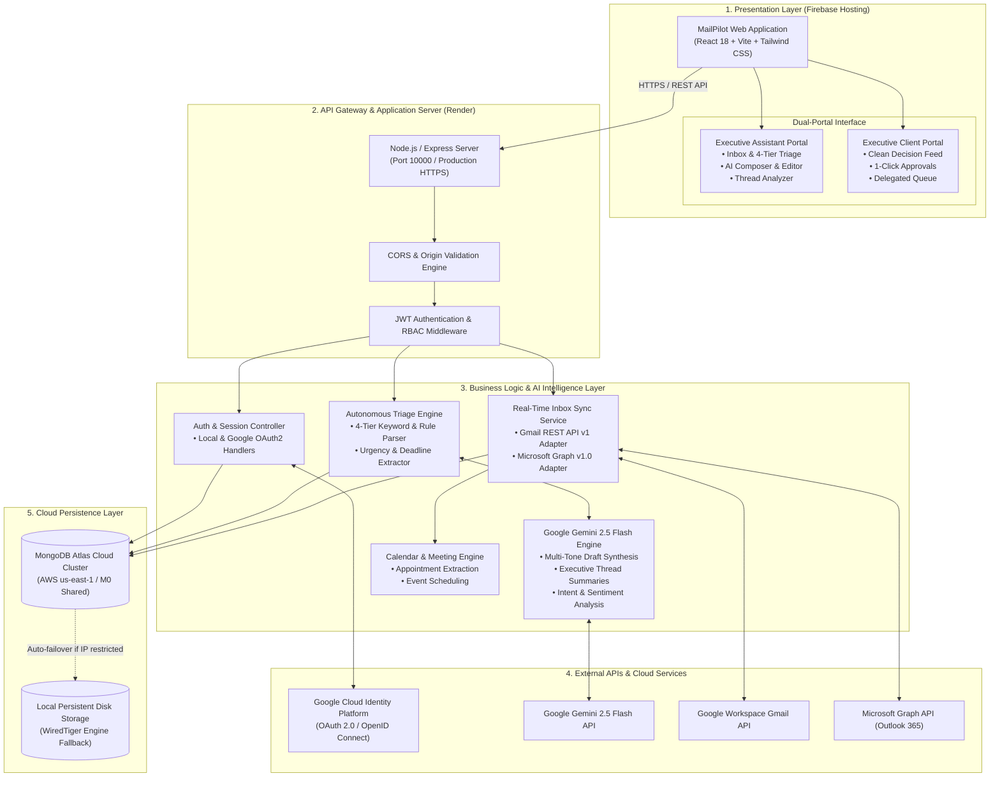
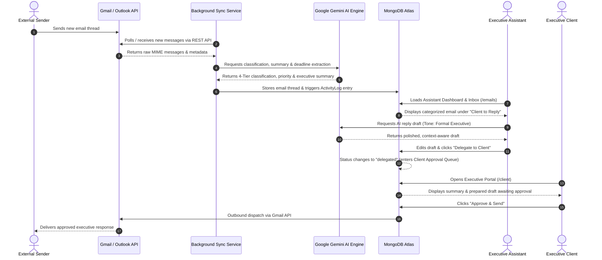
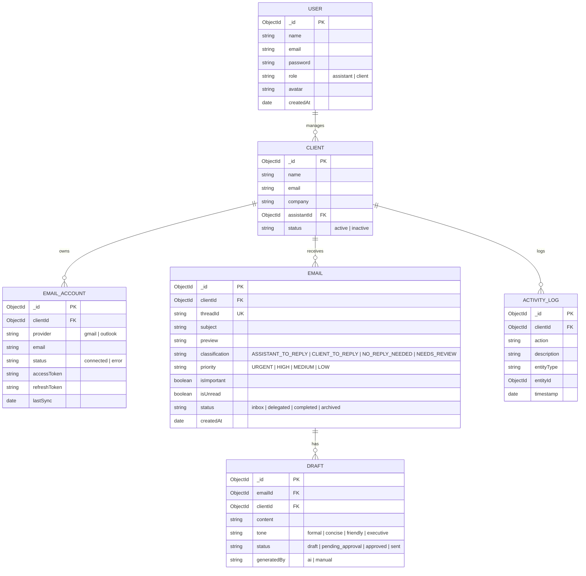

# 🏗️ MailPilot AI — System Architecture & Component Specification

This document provides a detailed architectural breakdown of the **MailPilot AI** platform, illustrating the interaction between the frontend client applications, backend application services, artificial intelligence engines, third-party communication APIs, and the cloud persistence layer.

---

## 1. High-Level System Architecture

The following diagram illustrates the complete end-to-end topology of MailPilot AI across its four core tiers: Client Presentation, API Gateway & Application Services, AI & Integration Engines, and the Cloud Persistence Layer.

---

## 2. Email Lifecycle & AI Triage Sequence

This sequence diagram details how an incoming email is fetched, processed by the AI layer, presented to the assistant, delegated, and approved by the executive client.

---

## 3. Database Entity-Relationship Model (ERD)

The data model is structured in MongoDB Atlas to support multi-account linking, robust thread tracking, and complete audit logging:

---

## 4. Technology Stack & Deployment Specifications

| Layer | Technology | Hosting / Platform | Key Responsibilities |
| :--- | :--- | :--- | :--- |
| **Frontend** | React 18, Vite, Tailwind CSS, Lucide Icons | **Firebase Hosting** (`mailpilot-ai-app.web.app`) | Dual-portal responsive UI, client-side routing, optimistic state updates. |
| **Backend** | Node.js 20, Express, JWT, Morgan, Helmet | **Render.com** Web Service (`mailpolitai.onrender.com`) | RESTful API routes, OAuth2 callback handshakes, role-based authorization. |
| **AI Intelligence** | Google Gemini 2.5 Flash API + Neural Rule Engine | **Google Cloud Vertex / AI Studio** | Sub-second email classification, tone adaptation, and executive summarization. |
| **Persistence** | MongoDB 7.0 + Mongoose ODM | **MongoDB Atlas** (AWS US-East Cluster) | Document storage with automated indexing on threadId, clientId, and timestamps. |
| **Integrations** | Google Workspace OAuth 2.0, Microsoft Graph API | **Google Cloud Platform & Azure** | Multi-inbox message synchronization and calendar event extraction. |
